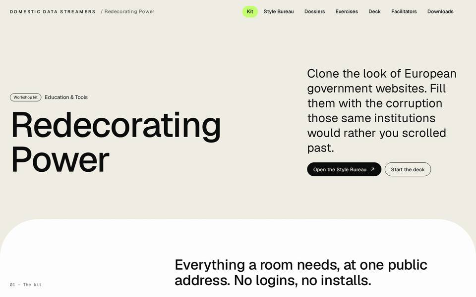
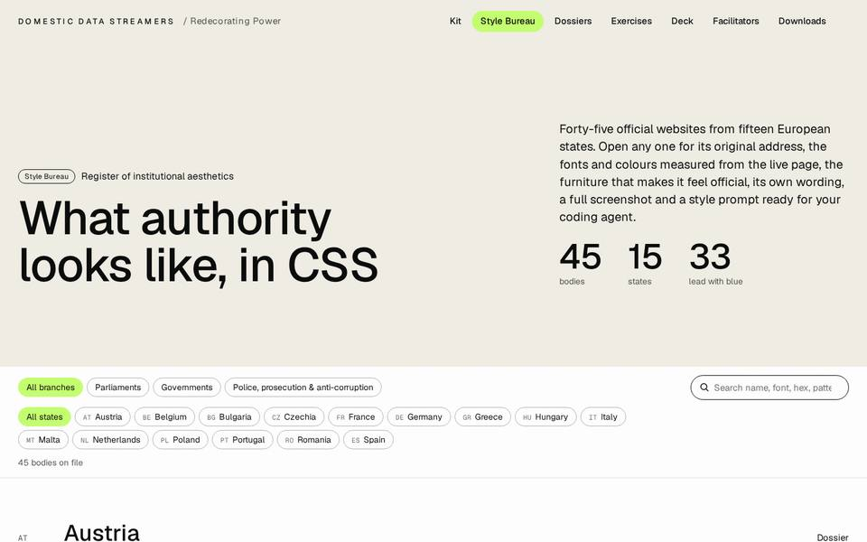
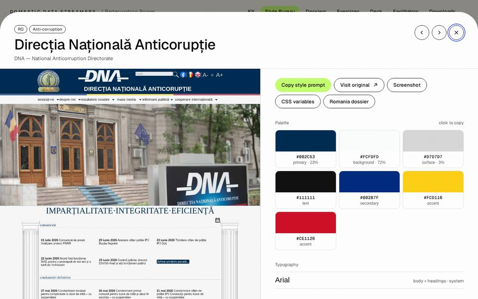
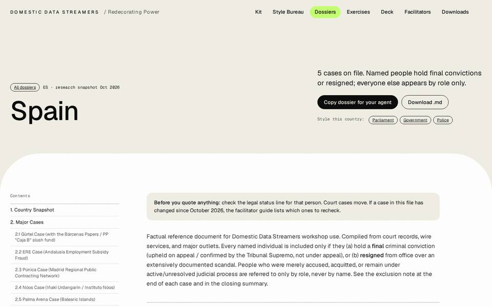
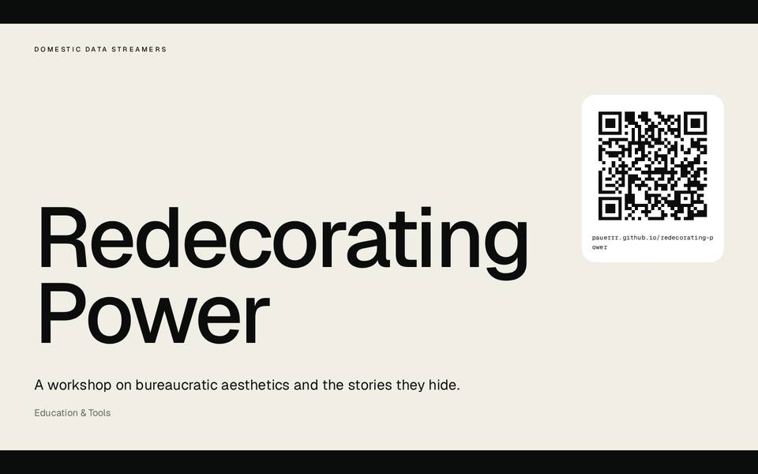
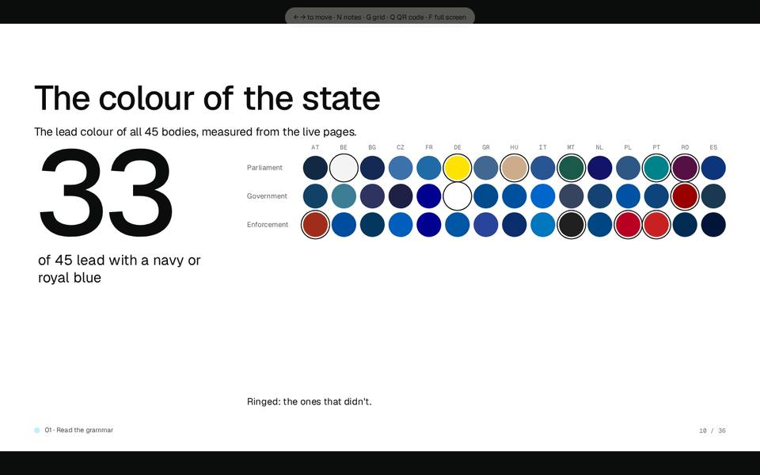

# Redecorating Power

A workshop kit by [Domestic Data Streamers](https://www.domesticstreamers.com). Participants clone the look of a real European government website — a parliament, a prime minister's office, a police force, an anti-corruption bureau — closely enough to be uncomfortable, then fill it with the documented corruption that same state has on record.

Same font. Same blue. Same cookie banner. Opposite content.

The room already knows how to vibe-code. What the session teaches is how to read design as an argument, and how to answer it in its own language.

**Live kit:** https://pauerrr.github.io/redecorating-power/

| | |
|---|---|
|  |  |
|  |  |
|  |  |

## What's in the kit

| Page | What it does |
|---|---|
| `/` | The hub. Run of show, the rule, links to everything, a QR code to the kit. |
| `/bureau/` | **Style Bureau.** 45 government bodies across 15 states. Original link, fonts and colours measured from the live pages, layout anatomy, signature UI patterns, the institution's own wording, full screenshot, and a one-click style prompt for a coding agent. |
| `/dossiers/` | **Dossiers.** One per country: cases, amounts, sentences, connection maps, the language of denial. Every claim sourced. Copyable as markdown. |
| `/exercises/` | **Seven worksheets**, one per phase. Fillable on screen (answers stay in the browser) or printable one per A4 page. |
| `/deck/` | **The presentation**, phase by phase, with speaker notes. Runs in any browser. |
| `/facilitator/` | **Facilitator guide.** Setup checklist, timings for 2h / 3h30 / full day, failure modes, publishing rules, and the watchlist of court cases to recheck. |
| `/downloads/` | PowerPoint deck, all dossiers as markdown, all screenshots, the token JSON. |

Countries: Austria, Belgium, Bulgaria, Czechia, France, Germany, Greece, Hungary, Italy, Malta, Netherlands, Poland, Portugal, Romania, Spain. Three bodies each.

## The rule

Every person named holds a **final conviction** for a corruption-related offence, or **resigned** over a documented scandal and is described only as having resigned. People on trial, acquitted, or cleared on appeal appear by role only. Institutional findings (OLAF, EU audits, US Treasury sanctions, parliamentary inquiries) are attributed to the institution that made them.

This is what makes the workshop possible. It also makes the work better.

## Publish your own edition (about five minutes)

1. **Fork** this repository on GitHub (or create a new repository and upload this folder's contents).
2. Edit **`assets/edition.js`**: event, city, venue, date, time, facilitators, format (`"2h"`, `"3h30"` or `"full-day"`), and the public address you're about to get. Leave anything blank to hide it.
3. In the repository: **Settings → Pages → Build and deployment → Deploy from a branch → `main` / root → Save.**
4. After a minute the kit is live at `https://<your-user>.github.io/<repository-name>/`. Put that address in `siteUrl` in `edition.js` and commit. QR codes on the home page and the deck now point at it.
5. Open `/deck/` on the venue's machine, press **F** for full screen.

Everything is static HTML. No build step is needed to publish. Fonts and the QR library are bundled, so the kit works on a flaky venue network once it has loaded.

### Deck controls

`→` / `←` / space / click — move · **N** speaker notes and session timer (**T** to start) · **G** slide grid · **Q** QR code overlay · **F** full screen · `#12` in the address opens slide 12.

## Updating the content

The pages under `/dossiers/`, `/facilitator/` and `/data/` are generated. Edit the sources in `/content/`, then rebuild:

```bash
pip install markdown
python3 build.py
```

| To change… | Edit | Then |
|---|---|---|
| A fact in a dossier | `content/dossiers/<country>.md` | `python3 build.py` |
| A style entry (wording, layout notes) | `content/styles/<country>.json` | `python3 build.py` |
| The facilitator guide | `content/facilitator-guide.md` | `python3 build.py` |
| Slide text or speaker notes | `deck/slides.js` | rebuild the PowerPoint (below) |
| Screenshots and measured colours/fonts | — | `python3 tools/capture.py [ids]`, then `python3 build.py` |

**Court cases move.** Before each edition, go through the watchlist at the end of the facilitator guide and update any dossier whose case has changed. A person enters the named list only with a final conviction or a documented resignation.

### Rebuilding the PowerPoint

```bash
cd tools
npm install
npm run pptx        # writes downloads/redecorating-power-deck.pptx
```

It reads the same `deck/slides.js` as the browser deck, so the two never drift apart.

### Refreshing screenshots and tokens

```bash
pip install playwright pillow
python3 -m playwright install chromium
python3 tools/capture.py                 # all 45
python3 tools/capture.py greece_police   # just one
python3 build.py
```

Some government sites block data-centre networks or answer automated browsers with a CAPTCHA. Run the script from an ordinary connection, or capture those few by hand. Don't automate CAPTCHAs.

## Design

The kit follows the visual language of domesticstreamers.com. See [`DESIGN.md`](DESIGN.md) for tokens and patterns.

## Repository map

```
index.html            hub
bureau/               Style Bureau
dossiers/             generated dossier pages (+ md/ raw copies)
exercises/            worksheets
deck/                 HTML deck + slides.js (the script for both decks)
facilitator/          generated guide
downloads/            pptx, zips, downloads page
data/                 generated styles.json + styles.js
screenshots/          45 full captures (+ thumbs/)
assets/               dds.css, doc.css, site.js, edition.js, qrcode.js, fonts/
content/              SOURCES: dossiers/*.md, styles/*.json, facilitator-guide.md
tools/                build-pptx.js, capture.py
build.py              regenerates the generated folders from content/
```

## Credits and licences

Kit by Domestic Data Streamers. Interface type: Roobert where installed (licensed, not bundled); Geist and Geist Mono everywhere else (SIL Open Font License, bundled in `assets/fonts/`). QR codes: qrcode-generator (MIT). Screenshots and design tokens of public government websites are reproduced for criticism, parody and education. Dossiers compiled from court records, institutional reports and major news outlets; sources linked inline. Research snapshot: October 2026.
